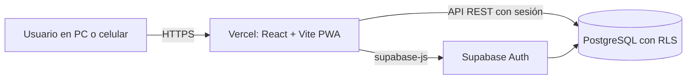

<p align="center">
  
</p>

<h1 align="center">HabitHero</h1>

<p align="center">
  <strong>Construye tu leyenda.</strong><br />
  El héroe que construye con sus hábitos.
</p>

HabitHero es una aplicación web instalable (PWA) que convierte la vida diaria en un videojuego. Un personaje 2D representa al usuario con **500 puntos de vida**: los malos hábitos le quitan vida, los buenos le dan **experiencia (XP)** por área de la vida y una moneda ficticia, los **Reales**, que se gastan en una tienda de recompensas con precios altos. Si la vida llega a 0, el personaje cae y solo vuelve al juego al cumplir un reto exigente.

La idea es moderar, no prohibir: los placeres existen en la tienda, pero hay que ganárselos.

> Proyecto personal de uso propio (un solo usuario), construido con el objetivo de practicar desarrollo full stack con React, TypeScript y PostgreSQL.

## Capturas

| Inicio | Áreas de vida | Tienda |
|---|---|---|
|  |  |  |

| Jefes | Logros y medallas | Historial |
|---|---|---|
|  |  |  |

| Pantalla de caído | Versión móvil |
|---|---|
|  |  |

## Funciones

- **Hábitos buenos y malos** con puntos configurables, frecuencia diaria, semanal o mensual y topes semanales.
- **Vida de 500 puntos** que no se regenera, y **retos de revivir** que se eligen de una lista.
- **XP por área** (9 áreas de la vida) con niveles que crecen de forma progresiva, para ver dónde falta atención.
- **Rachas**: cumplir un mismo hábito varios días seguidos multiplica sus recompensas.
- **Tienda de recompensas** con historial semanal y mensual de compras.
- **Jefes** mensuales y trimestrales con etapas, que dan XP y Reales al derrotarlos.
- **27 logros con medallas** de cinco niveles (bronce, plata, oro, rubí y legendaria), que se desbloquean automáticamente.
- **Historial** por semana y por mes, día por día.
- **Ajustes** para editar hábitos, precios, retos y reglas del juego sin tocar la base de datos.
- **Instalable** en PC y celular, con inicio de sesión de un solo usuario.

## Tecnologías

| Capa | Herramienta |
|---|---|
| Interfaz | React, TypeScript y Vite |
| Navegación | React Router |
| Íconos | Lucide |
| Base de datos y autenticación | Supabase (PostgreSQL) |
| App instalable | vite-plugin-pwa |
| Publicación | Vercel |

## Cómo funciona



Decisiones de diseño principales:

- **Modelo basado en eventos.** La vida, los Reales y el XP no se guardan como números sueltos: se calculan sumando cada hábito marcado, cada compra y cada jefe derrotado. Así el historial, las rachas y los logros salen de los mismos datos.
- **Cada registro guarda los puntos del momento.** Cambiar el valor de un hábito en Ajustes no reescribe el pasado.
- **Seguridad por filas (RLS).** Todas las tablas con datos personales solo son accesibles para el usuario con sesión iniciada y dueño de las filas. El registro de nuevos usuarios está desactivado.
- **Lógica pesada en la base de datos.** Vistas y funciones SQL calculan totales, XP por área, resúmenes diarios y el desbloqueo de logros, para evitar traer miles de registros al navegador.

Más detalle en [docs/ARQUITECTURA.md](docs/ARQUITECTURA.md) y las reglas completas del juego en [docs/DISENO.md](docs/DISENO.md).

## Ejecutarlo en tu computador

**Requisitos:** Node.js 20.19 o superior (o 22.12+), Git y una cuenta gratuita de [Supabase](https://supabase.com).

1. Clona el repositorio e instala las dependencias:

   ```bash
   git clone https://github.com/AlejoAlvarez1111/habithero.git
   cd habithero
   npm install
   ```

2. Crea un proyecto en Supabase y, en **SQL Editor**, ejecuta en orden los archivos de la carpeta [`database/`](database/README.md) (del `01` al `08`).

3. En **Authentication > Users** crea tu usuario con correo y contraseña, y desactiva el registro de nuevos usuarios.

4. Ejecuta `database/seed.example.sql` para cargar áreas, hábitos, tienda y retos de ejemplo. Después puedes editarlo todo desde la pantalla **Ajustes**.

5. Copia `.env.example` como `.env.local` y completa tu **Project URL** y tu **publishable key** (Project Settings > API Keys).

6. Inicia la app:

   ```bash
   npm run dev
   ```

### Comandos

| Comando | Qué hace |
|---|---|
| `npm run dev` | Servidor de desarrollo en `http://localhost:5173` |
| `npm run build` | Revisa los tipos y genera la versión final |
| `npm run preview` | Sirve la versión final (permite probar la instalación PWA) |
| `npm run lint` | Revisa el código con ESLint |

## Estructura del proyecto

```
habithero/
├── database/          Esquema, vistas, funciones SQL y datos de ejemplo
├── docs/              Arquitectura, reglas del juego y capturas
├── public/            Logo, avatar e íconos de la app instalable
└── src/
    ├── auth/          Inicio de sesión (contexto y proveedor)
    ├── components/    Piezas de la interfaz (incluye ajustes/)
    ├── game/          Estado compartido del juego
    ├── hooks/         Carga de datos y acciones (useGame)
    ├── lib/           Reglas del juego, fechas y cliente de Supabase
    └── pages/         Pantallas: inicio, tienda, áreas, jefes, logros, historial, ajustes
```

## Hoja de ruta

- [ ] Misiones diarias y semanales según el área con menor nivel
- [ ] Revisión semanal con resumen y consejo
- [ ] Recordatorios
- [ ] Avatar que cambia con el nivel
- [ ] Demo pública con datos de ejemplo

## Licencia

[MIT](LICENSE)
