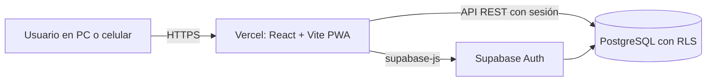
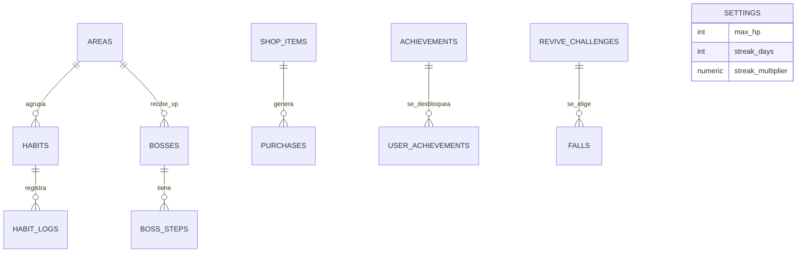

# Arquitectura

## Visión general

HabitHero es una aplicación de una sola página (SPA) que se comunica directamente con Supabase. No hay un servidor propio: la seguridad y la lógica de datos viven en PostgreSQL.

- **Frontend:** React con TypeScript, empaquetado con Vite. Se publica en Vercel y cada `git push` a `main` genera un despliegue nuevo.
- **Autenticación:** Supabase Auth con correo y contraseña. El registro de usuarios nuevos está desactivado, porque la app es de un solo usuario.
- **Datos:** PostgreSQL en Supabase, consultado desde el navegador con `supabase-js`.
- **Instalación:** `vite-plugin-pwa` genera el manifiesto y el service worker.

## Modelo de datos

| Tabla | Para qué sirve |
|---|---|
| `settings` | Reglas del juego del usuario: vida máxima, racha y zona horaria |
| `areas` | Las 9 áreas de la vida |
| `habits` | Hábitos buenos y malos, con nivel, puntos, frecuencia y área |
| `habit_logs` | Cada vez que se marca un hábito, con los puntos de ese momento |
| `shop_items` y `purchases` | Recompensas de la tienda y compras realizadas |
| `bosses` y `boss_steps` | Jefes mensuales y trimestrales con sus etapas |
| `achievements` y `user_achievements` | Catálogo de logros y los que el usuario ya consiguió |
| `revive_challenges` y `falls` | Retos de revivir y caídas del personaje |

### Un modelo basado en eventos

La vida, los Reales y el XP **no se guardan como columnas**. Se calculan a partir de los registros:

- **Vida** = vida máxima − vida perdida en los registros posteriores al último reto de revivir cumplido.
- **Reales** = Reales de hábitos + recompensas de jefes derrotados + recompensas de logros − compras.
- **XP de un área** = XP de los registros de sus hábitos + XP de los jefes derrotados de esa área.

Ventajas: el historial, las rachas y los logros salen de los mismos datos, no hay números que puedan quedar desincronizados, y cambiar los puntos de un hábito no reescribe el pasado, porque cada registro guarda los puntos del momento.

## Lógica en la base de datos

| Objeto | Tipo | Función |
|---|---|---|
| `player_totals` | Vista | Vida y Reales actuales |
| `area_totals` | Vista | XP por área |
| `daily_summary` | Vista | Resumen por día para el historial |
| `level_of(xp)` | Función | Nivel de un área (pasar del nivel n al n+1 cuesta 200 × n XP) |
| `max_run(fechas)` | Función | Racha más larga de días consecutivos (técnica de huecos e islas) |
| `check_achievements()` | Función | Evalúa los 27 logros, desbloquea los nuevos y devuelve cuáles se desbloquearon |

Se eligió calcular esto en SQL y no en el navegador por dos motivos: la API devuelve como máximo 1.000 filas por consulta, y los logros necesitan recorrer todo el historial.

Desde la app se llama a `check_achievements()` después de cada acción que puede desbloquear algo (marcar un hábito, comprar, derrotar un jefe, revivir), y los logros nuevos se muestran en un aviso.

## Seguridad

- **RLS** en todas las tablas con datos personales: política `user_id = auth.uid()`.
- Las vistas usan `security_invoker`, así que respetan las reglas de quien consulta.
- Los permisos se otorgan solo al rol `authenticated`; a `anon` no se le da ninguno.
- La llave que usa el navegador es la **publishable key**, diseñada para ser pública. La **secret key** nunca se usa en la app ni se sube al repositorio.
- Las variables de entorno están en `.env.local` (ignorado por Git) y en la configuración de Vercel.

## Interfaz

- `src/hooks/useGame.ts` carga hábitos, registros y totales, y expone las acciones (marcar, deshacer, recargar). El estado se comparte con todas las pantallas mediante un contexto.
- Las reglas puras del juego (estado de un hábito, rachas, niveles) están en `src/lib/game.ts`, separadas de la interfaz.
- Las fechas se calculan siempre con la zona horaria de Colombia (`America/Bogota`) en `src/lib/dates.ts`.
- El diseño es oscuro por defecto, con una paleta ligada a la marca: rojo para la vida, dorado para los Reales y menta para el progreso. Los botones respetan un tamaño táctil mínimo de 44 px y la navegación es accesible por teclado.

## Despliegue

1. Repositorio en GitHub, rama `main`.
2. Proyecto en Vercel conectado al repositorio, con las variables `VITE_SUPABASE_URL` y `VITE_SUPABASE_PUBLISHABLE_KEY`.
3. `vercel.json` redirige todas las rutas a `index.html`, para que las direcciones funcionen al recargar.
4. En Supabase, el **Site URL** apunta a la dirección de Vercel.
